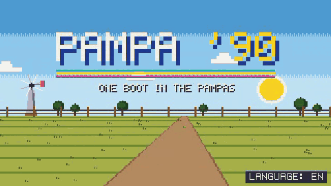
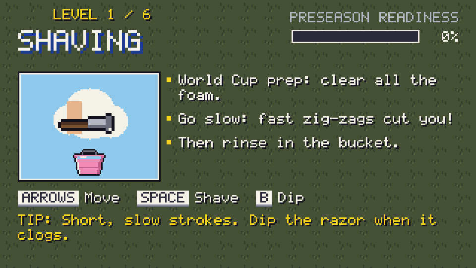
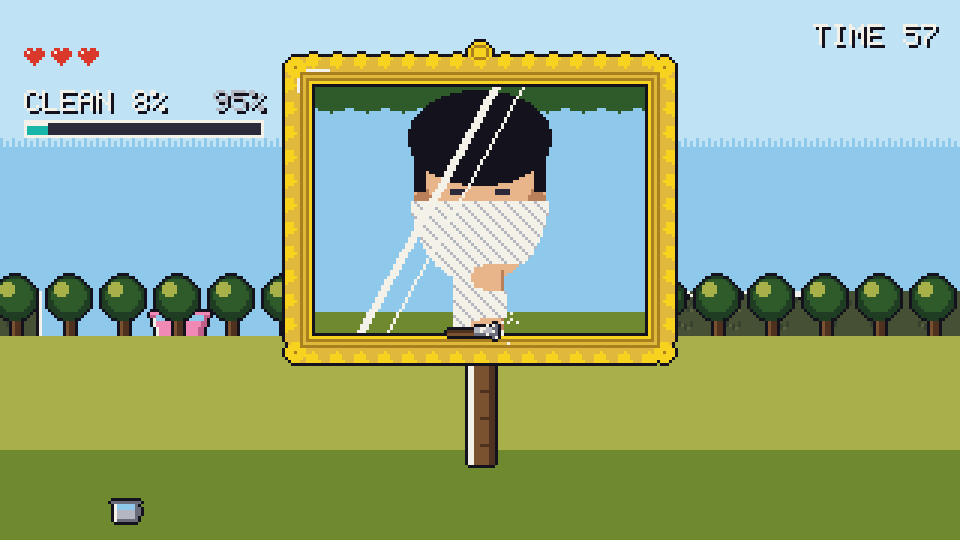
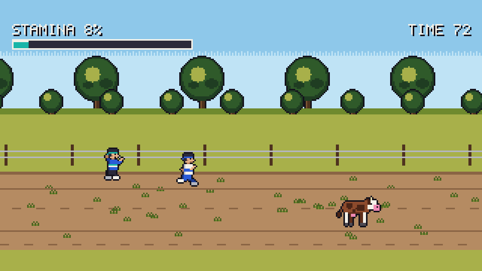
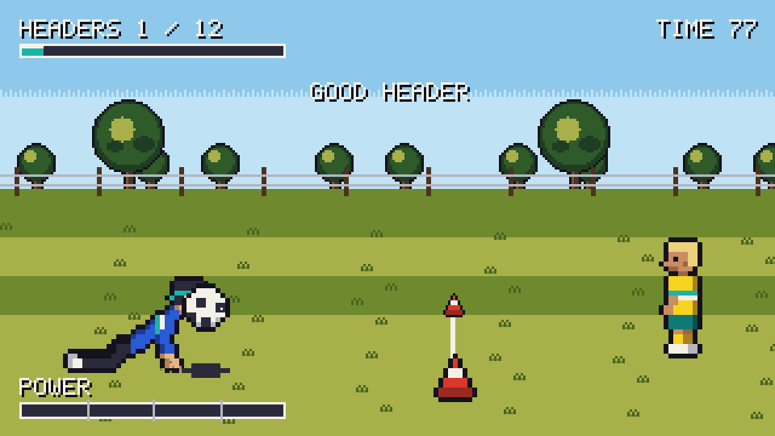
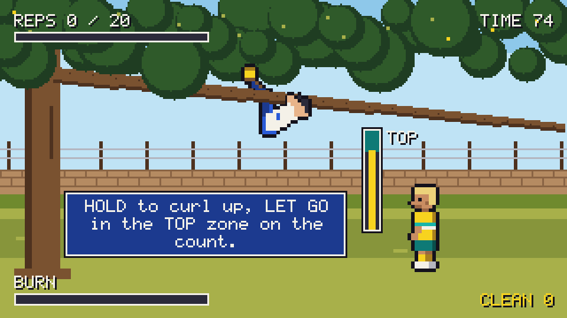
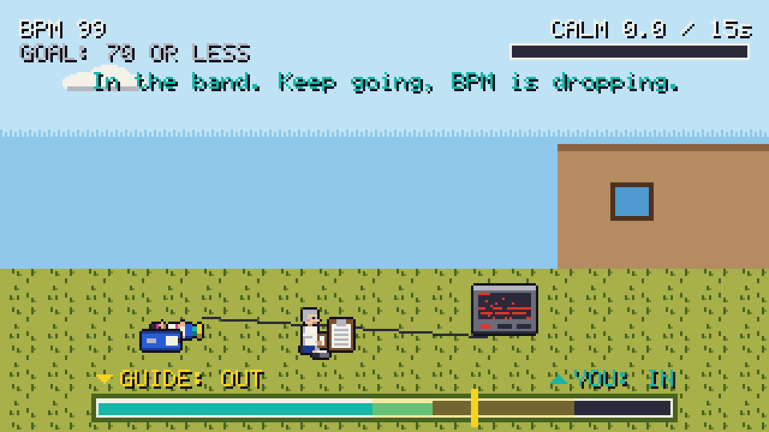
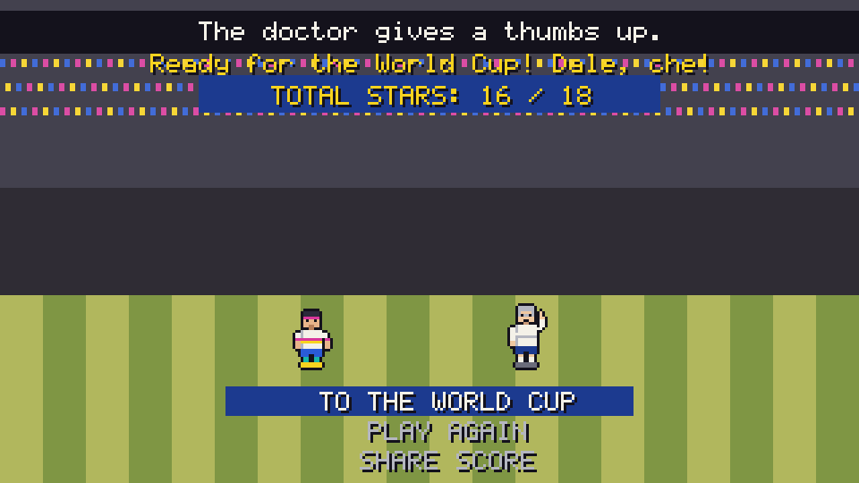
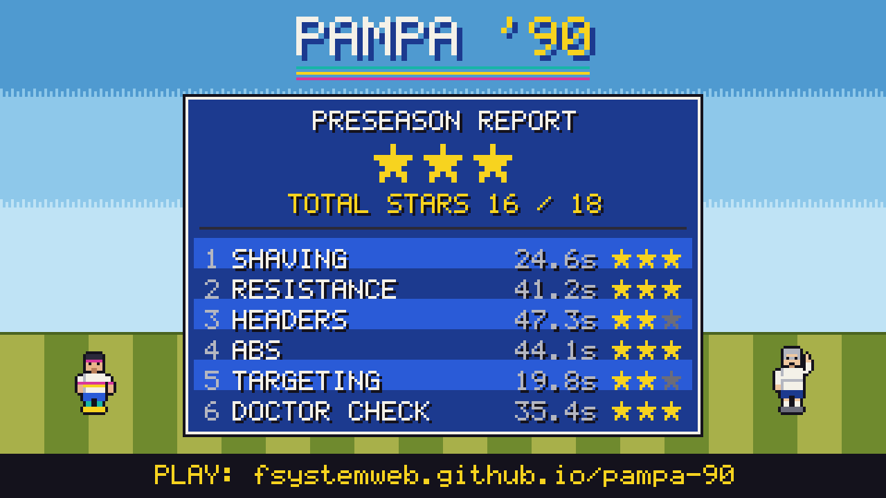

# Pampa '90

**▶ Play it: https://fsystemweb.github.io/pampa-90/** (desktop or phone in landscape, EN / ES)

8-bit web game: you are the best footballer in the world, mid-1990s, and your preseason is in the middle of La Pampa, Argentina. Intro + 6 short minigames (shaving, resistance, heading push-ups, upside-down abs, targeting, doctor check).



Vanilla JS (ES modules) + HTML5 Canvas, no build step. See [PLAN.md](PLAN.md).

## Screenshots

| | |
|---|---|
|  |  |
| **Title** | **Intro** |
|  |  |
| **Briefing** | **Shaving** |
|  |  |
| **Resistance** | **Heading push-ups** |
|  |  |
| **Upside-down abs** | **Targeting** |
|  |  |
| **Doctor check** | **Results** |
|  |  |
| **Ending** | **Share score card** |

## Run locally

ES modules need a server (not `file://`):

```sh
python3 -m http.server 8000
# open http://localhost:8000
```

## Layout

```
index.html
css/style.css
src/main.js          boot, loop, scaler
src/engine/          input, audio, sprites, scene, text, tween, save
src/scenes/          title, intro, levels, results, ending
src/data/            palette, strings
assets/              shipped assets; assets/sprites/atlas.* is a reference sheet of the code-generated sprites
tools/               export-atlas.sh regenerates the atlas (needs python3 + google-chrome)
tests/               Playwright smoke test + README screenshot / GIF scripts (dev only)
screenshots/         README images
reference/           mood/pose reference screenshots (NOT shipped)
```

## Controls

| Action | Keyboard | Gamepad | Touch (landscape) |
|---|---|---|---|
| Move / lanes / aim | Arrows or WASD | D-pad / stick | D-pad |
| Primary (shave, hop, push up / head, curl, jump, kick, breathe) | Space, Enter or Z | A | A |
| Secondary (dip razor, replay) | B, X or Shift | B | B |
| Pause menu (resume, reduced flash) | P or Esc | Start | II |
| Mute | M | | speaker button |
| Language (EN / ES) | L | | |

1. **Shaving:** arrows move the razor, hold primary to cut, B dips a clogged razor, rinse by holding primary and letting go in the green band.
2. **Resistance:** primary (or tap) hops, up / down switch lanes. Fill the stamina bar before the timer runs out.
3. **Heading push-ups:** lying face down, hold primary (A on touch) to load the push-up and let go just before the tossed ball arrives; low / mid / high tosses need more power. Every good header crawls you closer to the cones.
4. **Upside-down abs:** hanging from a branch, hold primary to curl up and let go in the TOP zone of the gauge on the coach's count (clean reps). Rushing, sloppy or bouncing reps make you swing (narrower top zone) and fill the burn bar; when it is full you hang and rest. 20 reps.
5. **Targeting:** press primary when the ring closes (perfect / good), press again to lock the aim on the sweeping reticle.
6. **Doctor check:** hold primary to breathe in, release to breathe out, follow the yellow guide.

Scores (best stars and times) are saved in the browser (localStorage); clearing site data resets them. Saves from older versions are migrated when levels are inserted (`src/engine/save.js`).

**Share your score:** after the doctor check, pick **SHARE SCORE** on the ending screen (arrows / D-pad + primary, or tap it). The game draws a pixel-art score card (total stars, rating, stars and best time per level, play link). On phones it opens the system share sheet (Web Share API); elsewhere it downloads `pampa-90-score.png` and copies the share text + link to the clipboard.

## Deploy (GitHub Pages)

The site is fully static. `.github/workflows/pages.yml` publishes `index.html`, `css/`, `src/` and `assets/` to https://fsystemweb.github.io/pampa-90/ on every push to `main` (`reference/`, `tools/`, `tests/` and `screenshots/` are not shipped). Pages → Source is set to "GitHub Actions".

## Tests (Playwright)

The game stays build-free: `package.json` only holds dev tooling (Playwright).

```sh
npm install
npx playwright install chromium firefox webkit   # once
npm run smoke          # Chromium only, quick
npm test               # Chromium + Firefox + WebKit
node tests/smoke.mjs --url https://fsystemweb.github.io/pampa-90/   # check the deployed build
```

`tests/smoke.mjs` serves the repo, walks title → intro → briefing → every minigame → results → ending → share, and fails on any console error, uncaught exception, failed request, blank frame or missing scene transition. It also checks EN + ES at load, mute, pause, integer canvas scaling, the score card (Web Share and the download fallback), and touch controls / rotate overlay / pause-on-portrait under iPhone (WebKit) and Pixel (Chromium) emulation. Screenshots of every step land in `screenshots/tmp/<browser>/` (git-ignored). CI runs it on every pull request (`.github/workflows/smoke.yml`).

README media: `npm run shots` rewrites the PNGs in `screenshots/`, `npm run record` the GIF (needs `ffmpeg`).

## Dev helpers

- `index.html#scene=<name>` starts at any scene (e.g. `title`, `dev-ui`).
- `index.html#scene=dev-sprites&page=N` browses every sprite (arrows = page, Space = background).
- `index.html#scene=level3` (or `level1` ... `level6`, `results`, `ending`) jumps straight to a level (numbered in the order of `src/data/levels.js`) or scene.
- `window.pampa.scenes.current` (or `.name`) in the browser console gives the active scene; `window.pampa.info()` sums up scene, pause reasons, audio state, language and canvas size.
